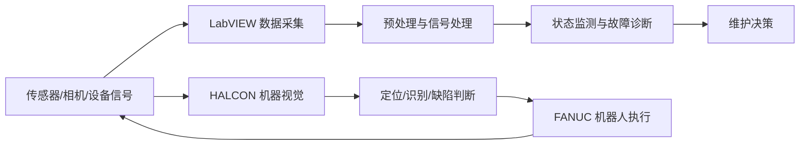

---
tags:
  - 大四
  - 知识地图
  - 智能制造
  - 系统集成
created: 2026-10-22
updated: 2026-10-23
---

# 知识地图 · 智能制造检测闭环

返回 [[大四专业课 · 总览]]

## 四门课如何衔接

| 系统层 | 主要课程 | 关键问题 |
| --- | --- | --- |
| 感知与采集 | [[课程 · LabVIEW虚拟仪器设计及应用]]、[[课程 · 机器视觉技术基础]] | 信号从哪里来？采样、标定和图像质量是否可信？ |
| 信息处理 | [[课程 · LabVIEW虚拟仪器设计及应用]]、[[课程 · 设备状态监测与故障诊断技术及其工程应用]] | 怎样抑制噪声、提取特征并形成可解释结论？ |
| 识别与测量 | [[课程 · 机器视觉技术基础]] | 怎样完成分割、匹配、标定与几何测量？ |
| 执行与联动 | [[课程 · FANUC工业机器人编程操作与仿真]] | 怎样通过坐标系、程序、I/O 和工作站完成动作？ |
| 健康与维护 | [[课程 · 设备状态监测与故障诊断技术及其工程应用]] | 怎样从振动、声学、油液、电气信号判断故障？ |

## 可复用的工程链路

1. 明确对象、故障/缺陷模式和验收指标。
2. 选择传感器、相机、采集卡与采样参数。
3. 做标定、同步、滤波、ROI 和数据质量检查。
4. 提取时域、频域、形状、纹理或模板匹配特征。
5. 形成阈值、规则、模型或诊断结论。
6. 通过机器人程序、I/O 或维护流程执行动作。
7. 保存原始数据、参数、结果和异常记录，支持复现。

## 与已有课程的连接

- [[课程 · 传感器与检测技术]]：传感器原理、标定、误差和数据融合。
- [[课程 · 单片机原理与应用]]：边缘采集、串行通信和接口控制。
- [[课程 · 电气控制与PLC应用技术]]：工作站联锁、顺序控制与现场 I/O。
- [[课程 · 机械制造技术基础]]：被测零件、加工误差与制造场景。
- [[课程 · 工程力学]]：振动、载荷、应力与失效机理的基础。

